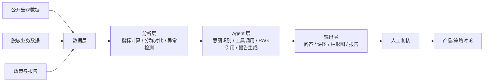
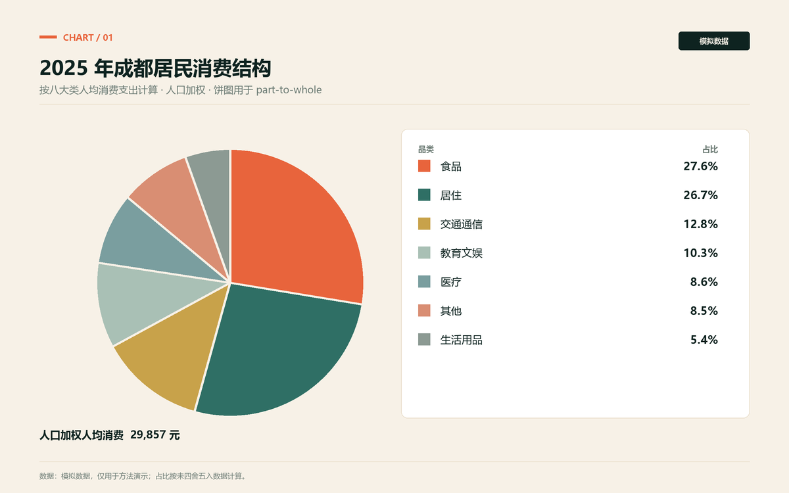
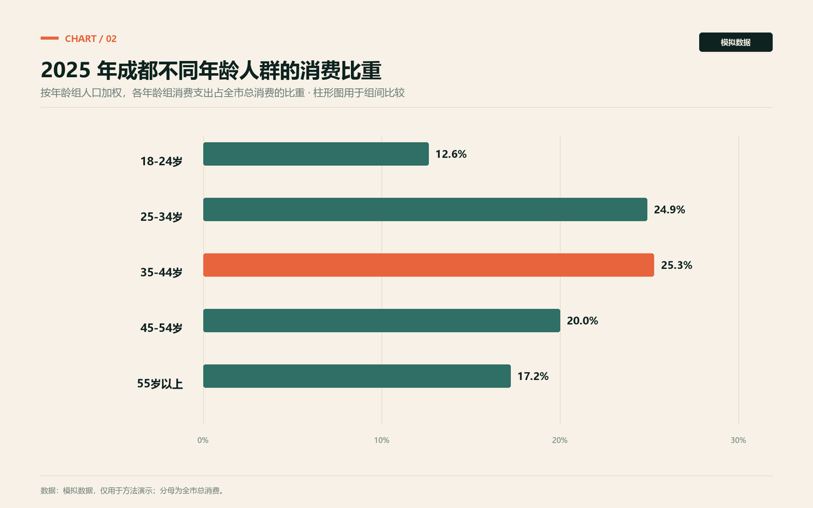
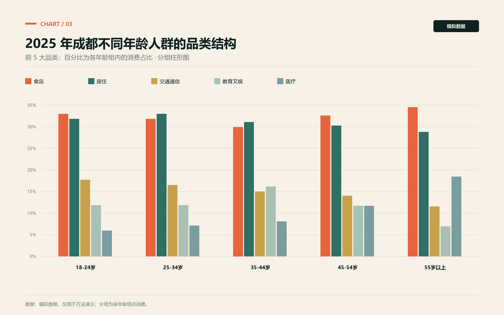

# Inclusive Livelihood Consumption Analyst

> 全球城市民生消费分析助手 · 一个可复用的 Agent Skill

[](#评估)
[](#评估)
[](#评估)
[](#评估)

**不是让 AI 替人放贷，而是让普惠金融在放贷之前，先看见具体的人。**

这个仓库把“民生消费分析”从一次性问答，整理成一套可复用的方法：

- **口径层**：指标定义、同比/环比、名义/实际、本币/PPP、COICOP；
- **流程层**：数据体检 → 结构扫描 → 变化追踪 → 群体分化 → 产品适配 → 合规检查；
- **模板层**：结论先行，每个判断按“发现—证据—含义—边界”展开；
- **边界层**：不授信、不歧视、不诱导、可复核；
- **图表层**：城市消费结构饼图、年龄组消费比重柱形图、年龄组品类结构分组柱形图；
- **全球层**：城市级/国家级、币种、PPP、分类映射、可比性等级 A/B/C。

适合：普惠金融/消金的产品经理、客户经理、策略分析、课程项目与政策研究。

---

## 这是什么

一个 **Agent Skill**：`SKILL.md` 是给 AI 的说明书，`references/` 是方法手册，`scripts/` 是可运行的分析/图表脚本，`assets/` 是模拟数据与评估量表。

它不输出个人授信结论，只做群体层面的描述性分析，并主动标注数据来源、口径和局限。

## 架构



核心原则：**AI 做副驾驶，人来做决定。**

## 快速开始

### 方式 1：在 DeepSeek Harness 中使用

DSH 会扫描工作区下的 `.dsh/skills/`。把整个仓库放进该目录：

```bash
cd <你的工作区>/.dsh/skills
git clone https://github.com/<your-name>/inclusive-livelihood-consumption-analyst.git
```

确认路径为：

```text
<工作区>/.dsh/skills/inclusive-livelihood-consumption-analyst/SKILL.md
```

然后刷新/重新打开 DSH，直接说：

> 用民生消费分析助手，分析成都新市民 2025 年的民生消费结构，和城镇常住居民比有什么不同。

或者：

> 比较柏林、新加坡、圣保罗 2025 年的消费结构，能不能直接排名？

或者：

> 用成都 2025 年数据，生成消费结构饼图和不同年龄人群的消费比重柱形图。

### 方式 2：在其他支持 SKILL.md 的 Agent 中使用

把整个文件夹放进该 Agent 的 skills 目录，确保 `SKILL.md` 在根目录，重新加载即可。

### 方式 3：只跑脚本

需要 Python 3 + pandas + Pillow：

```bash
python -m pip install -r requirements.txt

# 中国八大类
python scripts/analyze_livelihood.py \
  --input assets/sample_consumption.csv \
  --outdir outputs \
  --base-year 2024 \
  --compare-year 2025

# 全球城市 / PPP
python scripts/analyze_global.py \
  --input assets/sample_global_cities.csv \
  --outdir outputs_global \
  --base-year 2024 \
  --compare-year 2025

# 饼图 + 年龄组柱形图
python scripts/make_charts.py \
  --input assets/sample_age_groups.csv \
  --outdir outputs_charts \
  --city 成都
```

## 30 秒 Demo

### 中国城市

示例数据是**模拟数据**，仅用于方法演示：

| 群体 | 2025 人均消费 | 食品+居住 | 教育文化娱乐 |
|---|---:|---:|---:|
| 新市民·青年蓝领 | 26,100 元 | **57.2%** | 9.7% |
| 新市民·小微经营者 | 32,300 元 | 52.3% | 12.5% |
| 城镇常住居民 | 37,800 元 | 50.7% | 12.6% |

青年蓝领的食品+居住占比比城镇常住高 **6.5 个百分点**；教育文化娱乐增长 **13.4%**，但占比只有 **9.7%**——高增速、低基数，不宜直接说“消费升级”。

### 全球城市

| 城市 | 本地人均消费 | PPP 人均消费 | 食品+居住 | 可比性 |
|---|---:|---:|---:|---|
| Berlin | €25,600 | 34,133 国际元 | 42.0% | B |
| Singapore | S$40,000 | 29,630 国际元 | 41.0% | B |
| São Paulo | R$29,500 | 11,346 国际元 | 46.0% | B |

**不能**用 €25,600、S$40,000、R$29,500 直接比较生活水平；跨国水平比较必须用 PPP，并标注来源/年份。

## 图表示例

### 城市消费结构（饼图）



### 不同年龄人群的消费比重（柱形图）



### 不同年龄人群的品类结构（分组柱形图）



图表规则：饼图只用于 part-to-whole，类别 ≤7；年龄组比较用柱形图；柱形图纵轴从 0 开始；每张图写清分母、来源和“模拟/真实”。

## 目录结构

```text
inclusive-livelihood-consumption-analyst/
├─ SKILL.md                  # 技能主文件：角色、流程、输出规范
├─ README.md
├─ LICENSE
├─ requirements.txt
├─ .gitignore
├─ .github/workflows/tests.yml
├─ references/
│  ├─ indicator-system.md    # 指标公式、读法、常见陷阱、全球补充
│  ├─ analysis-playbook.md   # 六种分析套路
│  ├─ global-scope.md        # 数据源、COICOP 映射、PPP、可比性 A/B/C
│  ├─ chart-guidelines.md    # 饼图/柱形图选择与规范
│  ├─ compliance-guardrails.md
│  └─ report-template.md
├─ scripts/
│  ├─ analyze_livelihood.py  # 中国八大类分析
│  ├─ analyze_global.py      # 全球城市/PPP 分析
│  ├─ make_charts.py         # 饼图 + 柱形图
│  ├─ test_analysis.py       # 20 项计算断言
│  ├─ test_global_analysis.py# 10 项全球模式断言
│  ├─ test_charts.py         # 6 项图表断言
│  └─ test_rule_coverage.py  # 8 条规则覆盖检查
├─ assets/
│  ├─ sample_consumption.csv # 中国：3 群体 × 2 年 × 8 大类
│  ├─ sample_global_cities.csv # 全球：3 城 × 2 年 × COICOP-8
│  ├─ sample_age_groups.csv  # 成都：5 年龄组 × 8 大类（含人口）
│  ├─ data-notes.md
│  ├─ demo_questions.md
│  └─ eval_rubric.md
├─ examples/                 # 示例输出、图表与测试结果
└─ outputs/                  # 运行时生成（git 忽略）
```

## 评估

| 层级 | 检查 | 当前结果 |
|---|---|---|
| 中国计算层 | 总计、占比、增速、贡献度 | **20/20** 断言通过 |
| 全球模式 | 币种、PPP、分类、可比性 | **10/10** 断言通过 |
| 图表层 | 饼图/柱形图、分母、顺序、尺寸 | **6/6** 断言通过 |
| 规则层 | 同比/环比、名义/实际、个人授信、敏感属性、过度借贷、人工复核 | **8/8** 文档覆盖 |
| 用户层 | 10 份摘要 × 3 位同学盲评 | 下一步 |

> 规则覆盖检查只证明规则写入了文档，不证明模型在每次生成中都遵守；用户盲评尚未完成。我们不想把“小样本通过”说成“通用可靠”。

运行测试：

```bash
python scripts/test_analysis.py
python scripts/test_global_analysis.py
python scripts/test_charts.py
python scripts/test_rule_coverage.py
```

## 数据与合规

- 中国宏观背景使用国家统计局 2025 年公开数据：[《2025 年居民收入和消费支出情况》](https://www.stats.gov.cn/sj/zxfb/202601/t20260119_1962321.html)。
- 示例 CSV 均为**模拟数据**，基于公开结构校准，不代表任何地区/群体的真实情况。
- 全球模式：不同币种的名义金额不能直接比较；跨国水平比较必须用 PPP 或实际价格，并标注来源/年份。
- 全球模式：国家级数据不能写成城市数据；可比性等级 A/B/C 必须标注。
- 不输出个人授信、额度、利率、通过率结论。
- 不推断种族、宗教、健康状况、残障、性取向、政治倾向等敏感属性。
- 不诱导过度借贷；个人层面决策需人工结合征信、收入、负债、反欺诈和适当性评估。
- 跨境使用需同时遵守当地数据保护、消费者保护与金融监管要求；正式业务使用前，需由机构合规/法务复核。

## 这个项目不做什么

- 不做个人信用评分/授信审批；
- 不做催收、定价、额度策略；
- 不把模拟数据包装成真实统计；
- 不用不同币种的名义金额做城市排名；
- 不宣称“提升转化率/降低风险”；
- 不替代人工复核。

## 贡献

欢迎提 Issue 或 PR，尤其是：

- 新的公开数据口径与来源；
- 全球城市/COICOP 映射与 PPP 数据；
- 公平性/适当性检查方法；
- 真实脱敏数据的回测思路；
- 新的分析场景（通勤、租房、子女教育、慢病用药等）。

## License

[MIT](LICENSE)

---

> 先口径，后数据；先结构，后结论；先证据，后建议。
